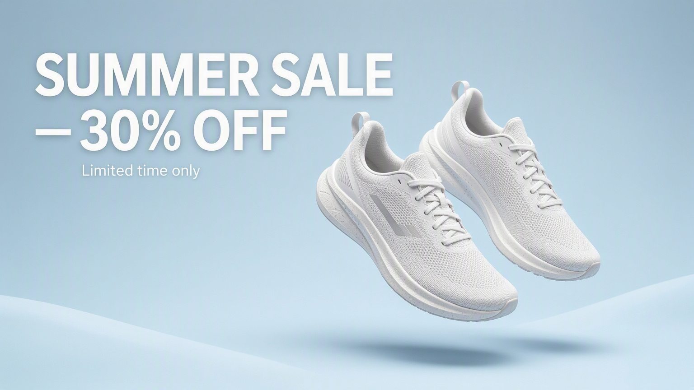
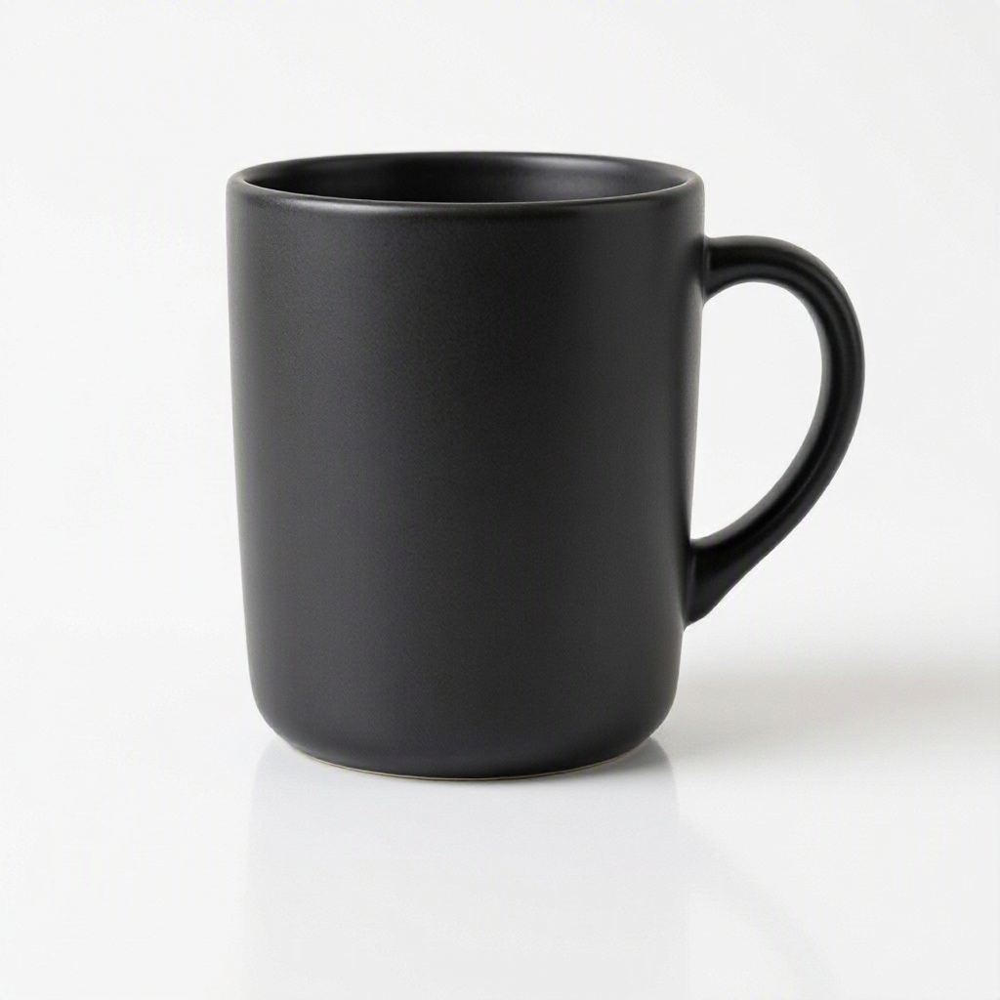
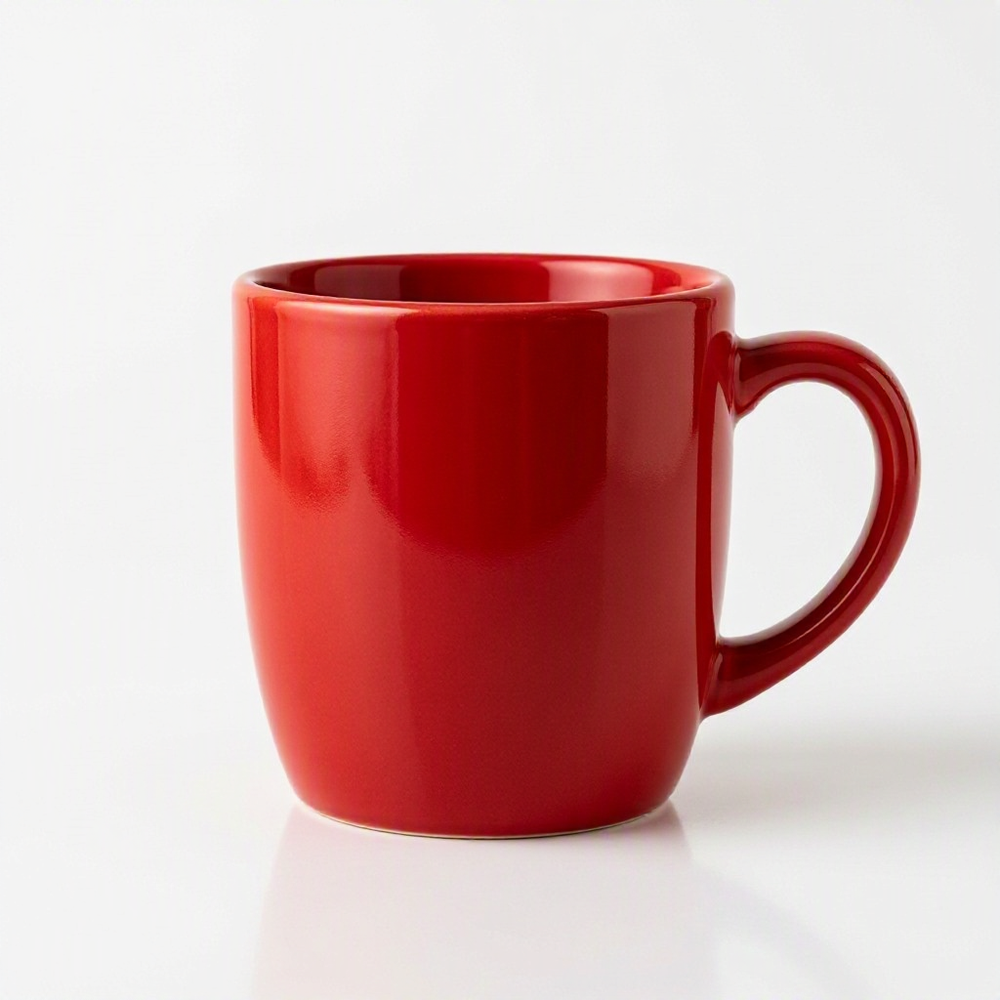
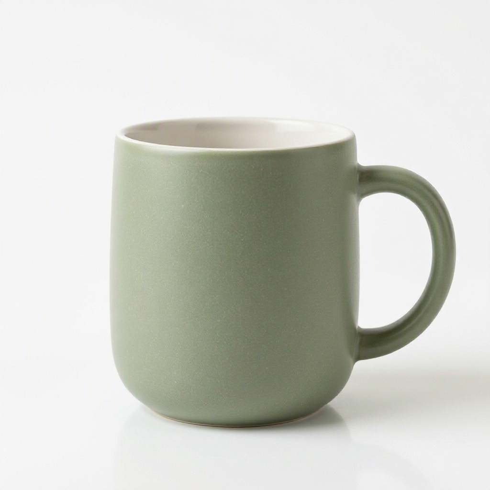
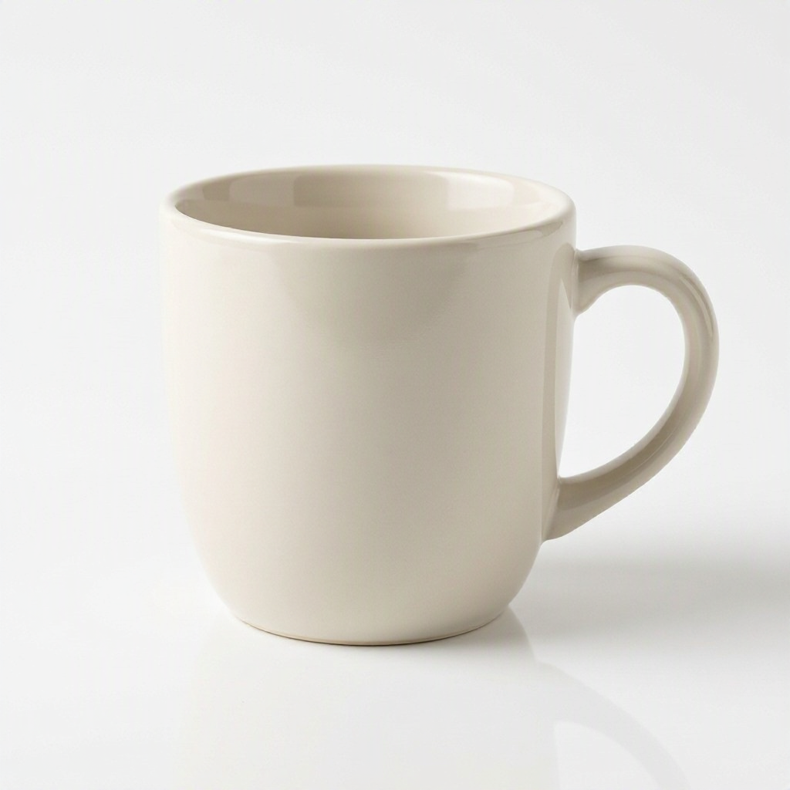
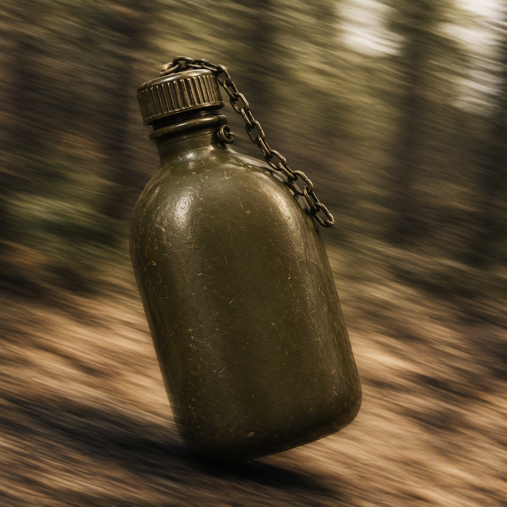
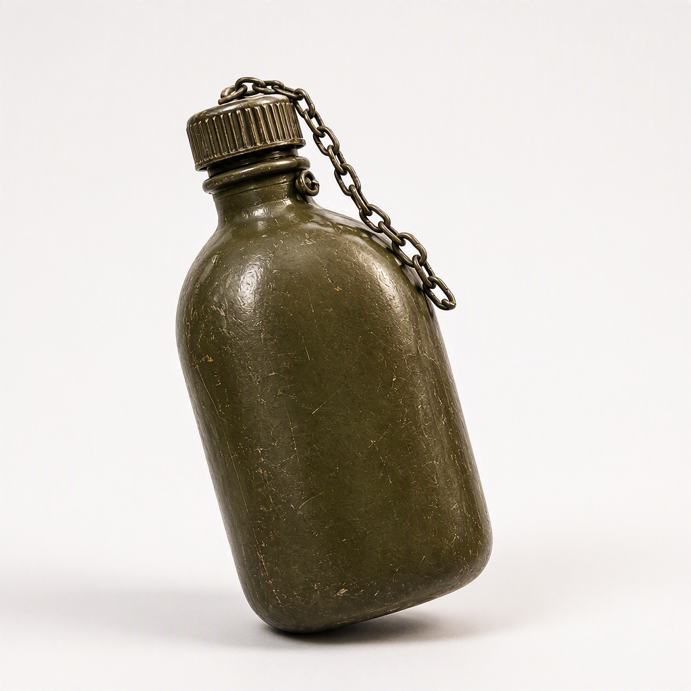

# MAI-Image-2.6 C# Demo on Microsoft Foundry


[](https://github.com/taswar/MAI-Image-26-Foundry-Demo/actions/workflows/dotnet.yml)

[](LICENSE)
[](CONTRIBUTING.md)

- 📖 Full walkthrough: [MAI Image 2.6 Lands in Foundry for C# Developers](https://taswar.zeytinsoft.com/mai-image-2-6-lands-in-foundry-for-c-developers/)
- ⭐ If this sample helps you, star the repo so other .NET developers can find it.
- 🔁 Related: [MAI-Image-2.5-Pro C# Sample](https://github.com/taswar/MAI-Image-2.5-Pro-Sample) and [GPT Image 2.5 Flare and Sunburst Demo](https://github.com/taswar/GptImage2.5-flare-sunburst-demo)
- For more C# samples using other AI models, see [AI models for C# developers](https://taswar.zeytinsoft.com/foundry-ai-models-csharp/)
- For my free ebook on prompt engineering, see [Prompt Engineering for .NET Developers](https://github.com/taswar/PromptEngineeringForDotNetDevelopers)

Console sample demonstrating the **MAI-Image-2.6** and **MAI-Image-2.6-Flash** models in
Microsoft Foundry: text-to-image generation, batch catalog generation, multi-reference
image editing, personalized image generation, and image cleanup/editing.

## Sample output

Every image below was generated by this sample and is in the repo.

**Campaign banner with legible headline text** (MAI-Image-2.6)



**Consistent catalog shots for four SKUs** (MAI-Image-2.6-Flash)

| SKU-1001 | SKU-1002 | SKU-1003 | SKU-1004 |
| --- | --- | --- | --- |
|  |  |  |  |

**Personalized greeting cards** (MAI-Image-2.6-Flash)

| Priya | Marcus | Aiko |
| --- | --- | --- |
|  |  |  |

**Cleanup: blurred background replaced with a studio background** (MAI-Image-2.6 edits)

| Before | After |
| --- | --- |
|  |  |

## Quick start

```powershell
git clone https://github.com/taswar/MAI-Image-26-Foundry-Demo.git
cd MAI-Image-26-Foundry-Demo
dotnet user-secrets set "AZURE_AI_FOUNDRY_ENDPOINT" "https://<your-resource-name>.services.ai.azure.com"
az login
dotnet run
```

## Requirements

- [.NET 10 SDK](https://dotnet.microsoft.com/download)
- An Azure subscription with a **Microsoft Foundry** resource that has `MAI-Image-2.6`
  and `MAI-Image-2.6-Flash` deployed (Global Standard deployment type)
- Access to the Foundry resource via **Microsoft Entra ID** (the sample authenticates
  with `DefaultAzureCredential`, e.g. `az login` or Visual Studio/VS Code sign-in), with
  the **Cognitive Services User** (or higher) role on the resource
- Reference input images placed in the project's working directory (see [Input files](#input-files) below)

## Configuration

The app reads `AZURE_AI_FOUNDRY_ENDPOINT` from .NET user secrets or an environment variable.

Set it with user secrets (recommended for local dev):

```powershell
dotnet user-secrets set "AZURE_AI_FOUNDRY_ENDPOINT" "https://<your-resource-name>.services.ai.azure.com"
```

Or via an environment variable:

```powershell
$env:AZURE_AI_FOUNDRY_ENDPOINT = "https://<your-resource-name>.services.ai.azure.com"
```

## Input files

The multi-reference editing and cleanup use cases read these images from the project's
working directory. The repo includes example files with these names. Replace them with
your own images, using the same names, to edit your own brand assets:

| File | Used for |
|---|---|
| `brand-mascot-reference.png` | Multi-reference channel reformatting |
| `product-shape-reference.png` | Multi-reference channel reformatting |
| `warehouse-photo-raw.png` | Image cleanup / surgical editing |

## Running the program

From the repository root (the folder that contains `MaiImage26FoundryDemo.csproj`):

```powershell
dotnet restore
dotnet build
dotnet run
```

## What it does

1. **Marketing & Campaign Production** — generates a summer sale banner with legible
   headline text (`campaign-summer-sale-banner.png`).
2. **Retail & E-Commerce Catalogs** — generates consistent product shots for a batch of
   SKUs (`catalog-SKU-*.png`).
3. **Brand & Creative Operations** — reformats a locked mascot + product reference pair
   into three channel formats (`instagram-square.png`, `story-vertical.png`, `banner-wide.png`).
4. **Personalization at Scale** — generates personalized greeting cards for a batch of
   recipients using the faster Flash model (`card-*.png`).
5. **Image Cleanup & Surgical Editing** — removes blur and replaces the background of a
   raw product photo while preserving its exact position (`product-cleaned.png`).

All generated images are written as PNG files to the project's working directory.

## Notes

- The MAI image edits API expects each reference image attached to a multipart form
  field named `image` (repeated once per file), not `image[]`.
- Up to 5 reference images are supported per edit request.
- The edits API doesn't take a size, so the three channel formats in use case 3 come back
  square (1024 × 1024) even though the prompts ask for 16:9 and 9:16.

## License

This project is licensed under the MIT License. See [LICENSE](LICENSE).
